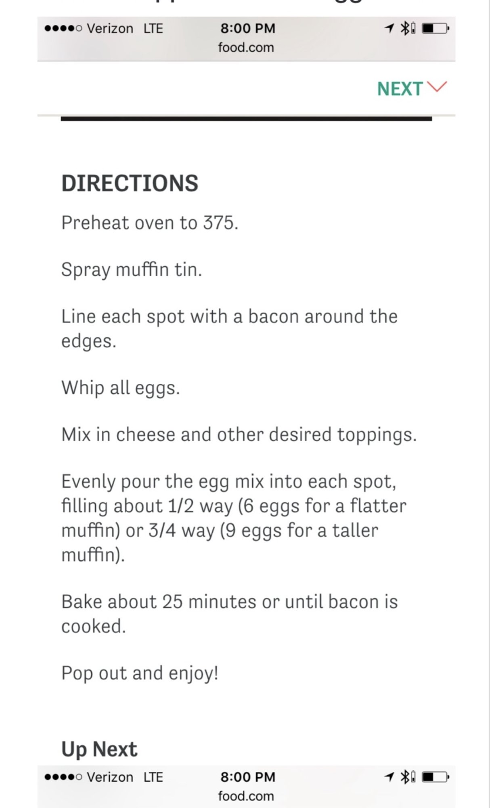

# Bacon Egg Muffin Cups

Eggs baked in a muffin tin lined with bacon. Only the directions were in the screenshot, so the title and amounts are partly reconstructed.

## Ingredients

- Bacon (one slice per muffin cup?)
- 6 eggs (flatter muffins) or 9 eggs (taller muffins)
- Cheese (amount ?)
- Other toppings you like
- Cooking spray

## Steps

1. Heat the oven to 375°F and spray a muffin tin.
2. Line each cup with bacon around the edges.
3. Whisk the eggs, then mix in the cheese and any toppings.
4. Pour into the cups, about half full (6 eggs) or three-quarters full (9 eggs).
5. Bake about 25 minutes, until the bacon is cooked. Pop out and serve.

## Notes

- 2026-11-14: Screenshot showed only the directions from food.com — original title, cheese amount and bacon count weren't visible.

## Source

food.com screenshot: 
