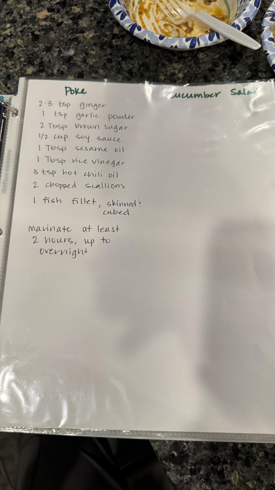

# Becca's Poke

Cubed fish in a soy, ginger and chili-oil marinade. Marinate at least 2 hours, up to overnight.

## Ingredients

- 2–3 tsp ground ginger
- 1 tsp garlic powder
- 2 Tbsp brown sugar
- 1/2 cup soy sauce
- 1 Tbsp sesame oil
- 1 Tbsp rice vinegar
- 3 tsp hot chili oil
- 2 scallions, chopped
- 1 fish fillet (type?), skinned and cubed

## Steps

1. Whisk together the ginger, garlic powder, brown sugar, soy sauce, sesame oil, rice vinegar and chili oil. Stir in the scallions.
2. Add the cubed fish and toss to coat.
3. Cover and refrigerate to marinate at least 2 hours, up to overnight.

## Notes

- 2026-11-14: Ginger is ground; fish is skinned (confirmed by Justin). Fish type not given on the card.

## Source

Becca's handwritten card: 
