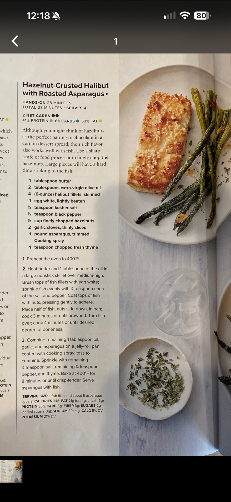

# Hazelnut-Crusted Halibut with Roasted Asparagus

Halibut with a finely chopped hazelnut crust, seared in butter and oil, with garlic-thyme roasted asparagus. Chop the nuts fine or they won't stick.

## Ingredients

- 1 Tbsp butter
- 2 Tbsp extra-virgin olive oil, divided
- 4 halibut fillets (6 oz each), skinned
- 1 egg white, lightly beaten
- 1/2 tsp kosher salt, divided
- 1/2 tsp black pepper, divided
- 1/2 cup finely chopped hazelnuts
- 2 garlic cloves, thinly sliced
- 1 lb asparagus, trimmed
- Cooking spray
- 1 tsp chopped fresh thyme

## Steps

1. Heat the oven to 400°F.
2. Heat the butter and 1 Tbsp oil in a large nonstick skillet over medium-high. Brush the tops of the fish with egg white; sprinkle with 1/4 tsp each salt and pepper. Press the hazelnuts onto the tops.
3. Cook half the fish nut side down 3 minutes, until browned. Turn and cook 4 minutes or to your liking. Repeat with the rest.
4. Toss the asparagus with the remaining 1 Tbsp oil and the garlic on a sprayed rimmed sheet pan. Sprinkle with the remaining salt, pepper and the thyme. Bake at 400°F for 8 minutes, until crisp-tender. Serve with the fish.

## Notes

- 2026-11-14: Per serving (1 fillet + ~5 spears): 348 cal, 21 g fat, 36 g protein, 5 g carb (2 net). Magazine name isn't visible on the page.

## Source

Magazine page: 
