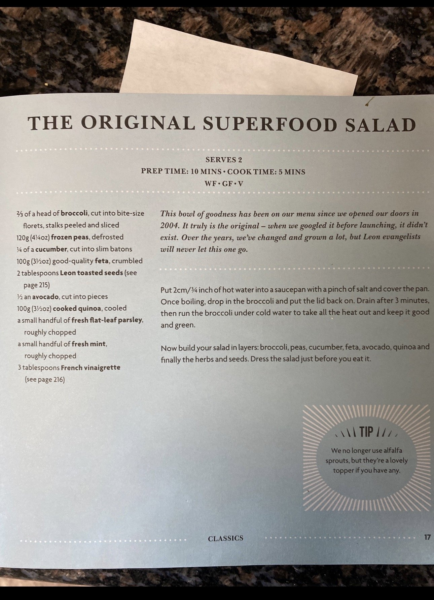
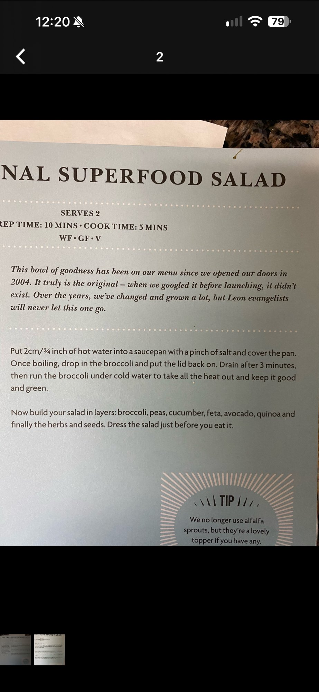

# The Original Superfood Salad (Leon)

Leon's signature layered salad: blanched broccoli, peas, cucumber, feta, avocado and quinoa with herbs and seeds. Book marks it wheat-free, gluten-free and vegetarian.

## Ingredients

- 2/3 head broccoli, bite-size florets; stalks peeled and sliced
- 120 g (4 1/4 oz) frozen peas, defrosted
- 1/4 cucumber, slim batons
- 100 g (3 1/2 oz) good feta, crumbled
- 2 Tbsp toasted seeds (Leon's recipe is on p. 215 — not saved)
- 1/2 avocado, in pieces
- 100 g (3 1/2 oz) cooked quinoa, cooled
- Small handful flat-leaf parsley, roughly chopped
- Small handful mint, roughly chopped
- 3 Tbsp French vinaigrette (Leon's recipe is on p. 216 — not saved)

## Steps

1. Bring about 3/4 inch (2 cm) of salted water to a boil in a covered saucepan. Add the broccoli, cover, and cook 3 minutes.
2. Drain and run under cold water to stop the cooking and keep it green.
3. Layer in a bowl: broccoli, peas, cucumber, feta, avocado, quinoa, then the herbs and seeds.
4. Dress just before eating.

## Notes

- 2026-11-14: Alfalfa sprouts make a good topper if you have them. The toasted seeds and vinaigrette are separate recipes in the book — send those pages if you want them filed.

## Source

Leon cookbook p. 17:  
