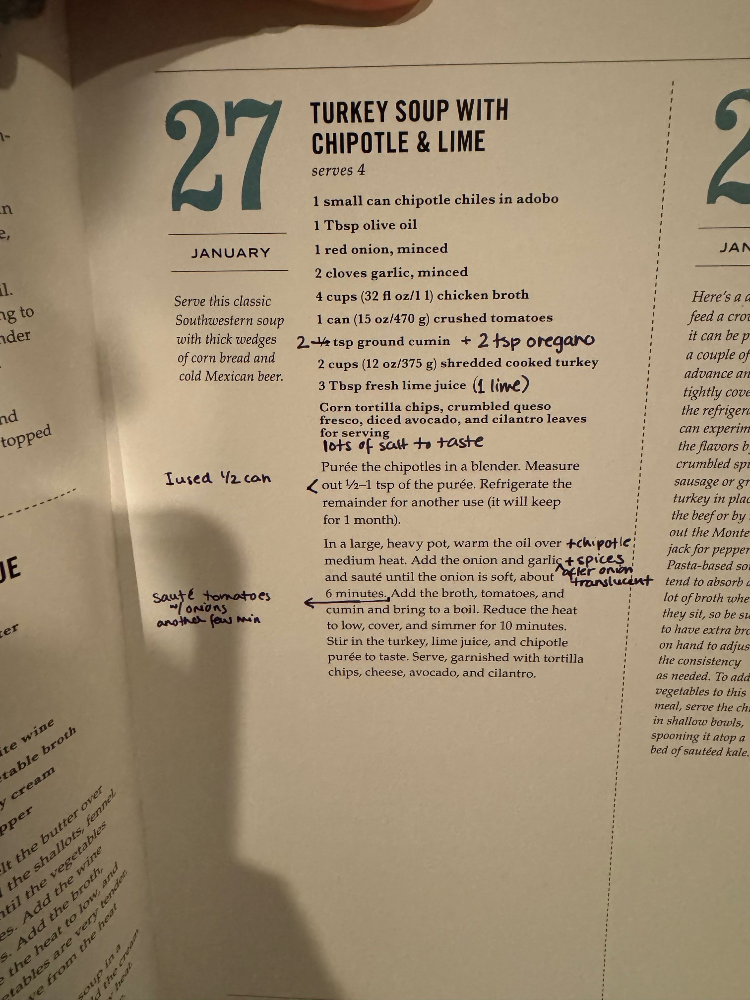

# Madu's Chipotle Chicken Tortilla Soup

A cookbook turkey soup with chipotle and lime, reworked by Madu: rotisserie chicken,
much more chipotle and spice, spices bloomed in the onions, and a longer simmer.

## Ingredients

- 1/2 can chipotle chiles in adobo (small can), puréed
- 1 Tbsp olive oil
- 1 red onion, minced
- 2 cloves garlic, minced
- 1 can (15 oz) crushed tomatoes
- 2 tsp ground cumin
- 2 tsp oregano
- 4 cups chicken broth
- 2 cups shredded Costco rotisserie chicken
- 3 Tbsp fresh lime juice (about 1 lime)
- Lots of salt, to taste
- For serving: corn tortilla chips, crumbled queso fresco, diced avocado, cilantro

## Steps

1. Purée the chipotles in a blender.
2. Warm the oil in a large heavy pot over medium heat. Add the onion and garlic and sauté until the onion is soft and translucent, about 6 minutes.
3. Add the chipotle purée, cumin and oregano and sauté for a bit.
4. Add the crushed tomatoes and sauté with the onions another few minutes.
5. Add the broth and bring to a boil. Reduce heat to low, cover, and simmer about 20 minutes.
6. Stir in the chicken and lime juice and simmer another 20–30 minutes.
7. Season with plenty of salt. Serve topped with tortilla chips, queso fresco, avocado and cilantro.

## Notes

- 2026-11-14: Madu made this for Soupfest 2026.
- 2026-11-14: Madu's mods vs. the printed recipe: chicken instead of turkey; 1/2 can chipotle instead of 1/2–1 tsp purée; cumin up from 1/2 tsp to 2 tsp, plus 2 tsp oregano; chipotle and spices sautéed with the onion; tomatoes sautéed a few minutes before the broth; simmer ~20 min, then 20–30 more with chicken and lime (printed: 10 min).
- 2026-11-14: Madu's note, verbatim: "Added way more spices and chipotle. I also sautéed the chipotle and spices in the onion garlic mixture for bit before adding broth. And I simmered the soup for longer than just 10min. Prolly 20min without chicken and then another 20-30 with the chicken and lime added. Oh and I just shredded up some Costco rotisserie chicken."

## Source

Cookbook page with Madu's handwritten notes: 
