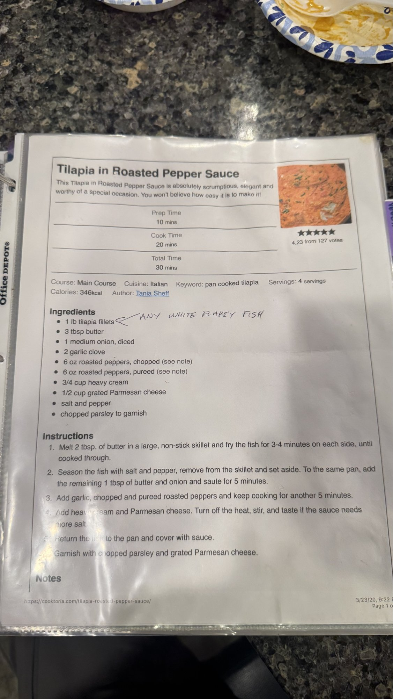

# Tilapia in Roasted Pepper Sauce

Pan-fried white fish in a creamy roasted red pepper and Parmesan sauce. Handwritten on the page: any white flaky fish works.

## Ingredients

- 1 lb tilapia fillets (or any white flaky fish)
- 3 Tbsp butter, divided
- 1 medium onion, diced
- 2 garlic cloves
- 6 oz roasted peppers, chopped
- 6 oz roasted peppers, puréed
- 3/4 cup heavy cream
- 1/2 cup grated Parmesan, plus more to garnish
- Salt and pepper
- Chopped parsley, to garnish

## Steps

1. Melt 2 Tbsp butter in a large nonstick skillet and fry the fish 3–4 minutes per side, until cooked through. Season, remove and set aside.
2. Add the remaining 1 Tbsp butter and the onion to the pan; sauté 5 minutes.
3. Add the garlic and the chopped and puréed peppers; cook another 5 minutes.
4. Add the cream and Parmesan, turn off the heat, stir, and salt to taste.
5. Return the fish to the pan and spoon the sauce over.
6. Garnish with parsley and Parmesan.

## Notes

- 2026-11-14: The page says "see note" for the roasted peppers, but the Notes section was blank on the printout.

## Source

Printed page (cooktoria.com): 
