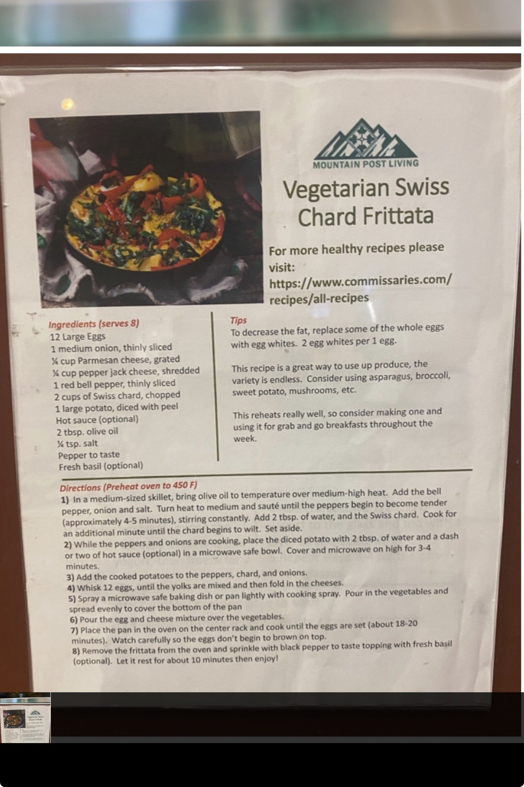

# Vegetarian Swiss Chard Frittata

A big 12-egg frittata with chard, peppers, onion and potato. Reheats well for grab-and-go breakfasts through the week.

## Ingredients

- 12 large eggs
- 1 medium onion, thinly sliced
- 1/4 cup Parmesan, grated
- 1/4 cup pepper jack, shredded
- 1 red bell pepper, thinly sliced
- 2 cups Swiss chard, chopped
- 1 large potato, diced, peel on
- 2 Tbsp olive oil
- 1/4 tsp salt
- Pepper to taste
- Hot sauce (optional)
- Fresh basil (optional)

## Steps

1. Heat the oven to 450°F.
2. Heat the oil in a medium skillet over medium-high. Add the bell pepper, onion and salt, turn to medium, and sauté, stirring, until the peppers start to soften, 4–5 minutes. Add 2 Tbsp water and the chard; cook about 1 minute until it wilts. Set aside.
3. Meanwhile, put the potato in a microwave-safe bowl with 2 Tbsp water and a dash or two of hot sauce (optional). Cover and microwave on high 3–4 minutes.
4. Add the potatoes to the peppers, chard and onions.
5. Whisk the eggs until the yolks are mixed, then fold in both cheeses.
6. Lightly spray a baking dish or pan, spread the vegetables over the bottom, and pour the egg mixture over.
7. Bake on the center rack until set, about 18–20 minutes; watch that the top doesn't brown.
8. Sprinkle with black pepper and basil (optional). Rest 10 minutes before cutting.

## Notes

- 2026-11-14: The sheet says "microwave safe baking dish," but it goes into a 450°F oven — use an oven-safe dish. To lighten it, swap some whole eggs for whites (2 whites per egg). Other veg work too: asparagus, broccoli, sweet potato, mushrooms.

## Source

Mountain Post Living recipe sheet: 
